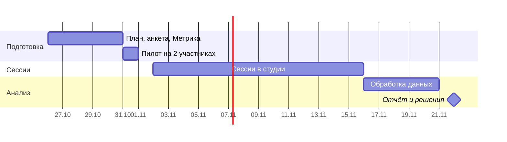

# Фокус-группы: шкала оценки и сценарий оценивания

> **Цель:** проверить на двух фокус-группах, понятна ли параметрическая шкала оценки и легко ли поставить оценку фильму · **Обновлено:** 24.10.2026 · **Ответственный:** Роман Стяжкин (PM)

**Статус:** план, готовится к запуску. **Партнёр:** киностудия (набор участников и проведение сессий).
**Материалы:** [анкета](focus-groups-form.md) · [комплект для ведущего](focus-groups-kit.md) · [скрипт создания формы](tools/focus-groups-form.gs)

## Кратко

| | |
|---|---|
| **Проблема** | Шкала оценки и сценарий её выставления спроектированы командой, но не проверены на людях. Если параметры непонятны или оценку трудно поставить, пользователь не дойдёт до целевого действия — оценки и рецензии (NSM) |
| **Метод** | Асинхронное немодерируемое юзабилити-тестирование: участник выполняет задания на сайте и отвечает на анкету. Дополнительно — записи сессий и карты кликов в Яндекс.Метрике |
| **Участники** | 2 группы по 20 человек: профессионалы кино и любители |
| **Окно** | 02.11–15.11.2026 (2 недели после релиза). Отчёт — 22.11.2026 |
| **Результат** | Список проблем с приоритетами, данные по каждому параметру шкалы, рекомендации. Решения об изменениях — в декабре, вместе с данными первого месяца работы |

## Предварительный этап: демо-версия

До релиза студия уже собирает обратную связь, поэтому её участники проходят интерфейс на **демо-данных** по [демо-версии анкеты](focus-groups-form.md#демо-версия-анкеты-до-релиза). Отличия от основного этапа: нет кодов участников, регистрации, Вебвизора и калибровочного фильма; каждый оценивает любой фильм из каталога.

- **Что даёт:** первые данные по И1, И2, И5–И7 — понятность параметров, сортировка аспектов, сложность сценария оценки, рецензии. Найденные критичные проблемы можно исправить до основного этапа.
- **Ограничения:** нет поведенческих данных и сравнения оценок одного фильма; на демо-данных интерфейс может вести себя иначе, чем на рабочем сайте.
- **Как учитываем:** ответы хранятся в отдельной таблице и в отчёте показываются отдельным блоком, без смешения с основным этапом. Если вопросы основной анкеты изменятся по итогам демо-этапа, это отмечается в отчёте.
- **Пересечение участников:** тот, кто прошёл демо-версию, не участвует в основном этапе — он уже знает интерфейс.

## 1. Контекст

Шкала из пяти параметров — ядро продукта: она отличает «Эхо» от площадок с одной цифрой (см. [систему оценок](../03-product/ratings-and-statuses.md)). Решение 10.2026 — не расширять функционал до проверки основной гипотезы. Поэтому исследование проверяет **существующее**, а не новое: найденные проблемы удобства исправляются как баги, изменения шкалы проходят по [регламенту изменений](../02-management/change-management.md).

Сессии проходят без PM и без фиксированного времени: участники приходят в студию в разное время, ведущий от студии сажает их за компьютер. Метод построен под этот формат: всё, что обычно видит модератор, мы получаем из записи сессии и из анкеты сразу после каждого задания.

## 2. Задачи исследования

| № | Задача | Что хотим узнать | Приоритет |
|---|---|---|---|
| И1 | **Шкала параметров** | Понятно ли, что оценивать в каждом параметре. Не пересекаются ли параметры. Покрывают ли они всё, что важно в фильме. Есть ли двусмысленность | Основная |
| И2 | **Сценарий выставления оценки** | Сколько усилий требует оценка: число шагов, поиск формы на странице фильма (её нет на первом экране), понятность ползунков, регистрация | Основная |
| И3 | **Итоговая оценка** | Совпадает ли итог 0–100 с личным ощущением участника от фильма | Основная |
| И4 | **Различия профессионалов и любителей** | Одинаково ли две группы понимают и используют параметры. Насколько расходятся их оценки одного фильма | Основная |
| И5 | **Ценность с первого взгляда** | Понятно ли с главной страницы, что это за сайт и для кого | Дополнительная |
| И6 | **Переход от оценки к рецензии** | Что мешает написать рецензию после оценки и что мотивировало бы. Это главный переход для NSM | Дополнительная |
| И7 | **Взгляд автора** (только профессионалы) | Полезна ли такая обратная связь создателю фильма. Каких параметров не хватает автору | Дополнительная |

**Не входит в исследование:** статусы и баллы, профиль, предпочтения, поиск, мобильная версия. Новые идеи функций, если участники их предложат, не обсуждаются в отчёте как планы: они оформляются [карточками функционала](../08-partners/feature-cards.md).

## 3. Гипотезы и критерии

Ориентиры утверждаются **до начала сессий**, чтобы потом не подгонять вывод под результат.

| Гипотеза | Как измеряем | Ориентир «подтверждено» |
|---|---|---|
| Г1. Каждый параметр понятен | Понятность параметра по шкале 1–5 | ≥ 80% участников ставят 4–5 каждому параметру |
| Г2. Параметры не пересекаются | Сортировка 14 аспектов фильма по параметрам | ≥ 70% согласия с ожидаемым параметром по каждому контрольному аспекту |
| Г3. Набора параметров хватает | Доля ответов «ни к одному» в сортировке; вопрос о недостающем параметре | «Ни к одному» < 20% по каждому аспекту; один и тот же недостающий параметр называют < 25% |
| Г4. Группы понимают шкалу одинаково | Согласие в сортировке и понятность по группам | Разница между группами ≤ 15 п.п. |
| Г5. Оценку поставить легко | SEQ (1–7); доля нашедших форму без помощи; время от открытия фильма до сохранения оценки | Медиана SEQ ≥ 6; ≥ 80% без помощи; медиана времени ≤ 2 мин |
| Г6. Итог совпадает с ощущением | Совпадение итога с ощущением по шкале 1–5 | ≥ 70% ставят 4–5 |
| Г7. Назначение сайта понятно сразу | Открытый ответ после 15 секунд на главной | ≥ 70% ответов совпадают по смыслу с позиционированием |

## 4. Метод

**Асинхронное немодерируемое юзабилити-тестирование** с триангуляцией: одна и та же проблема подтверждается несколькими источниками.

| Источник | Что даёт | Инструмент |
|---|---|---|
| Анкета после каждого задания | Самооценка сложности, понимание шкалы, причины, мнения | Google Формы ([вопросы](focus-groups-form.md)) |
| Запись сессии | Реальное поведение: где искал, где застрял, сколько шагов | Вебвизор Яндекс.Метрики |
| Карты кликов и скроллинга | Куда нажимают на странице фильма, доходят ли до формы оценки | Яндекс.Метрика, сегмент фокус-групп |
| События | Время и воронка: `movie_card_view` → `review_start` → `rating_submit` / `review_submit` | Яндекс.Метрика ([план аналитики](../05-business/analytics-plan.md)) |
| Оценки калибровочного фильма | Разброс значений по каждому параметру внутри группы и между группами | Выгрузка из БД по никнеймам |
| Заметки ведущего | Где участник просил помощи, технические сбои | Последний раздел анкеты |

**Как связываем источники.** У каждого участника есть код (`PR01`–`PR20` — профессионалы, `LB01`–`LB20` — любители). Код вшит в его ссылку на сайт (UTM-метка) и заранее заполнен в его ссылке на анкету. Поэтому запись сессии, события и ответы анкеты одного человека сопоставляются без имён и контактов.

**Ограничения метода и как их снижаем:**
- Нет «мысли вслух» и уточняющих вопросов → вопросы о сложности задаются сразу после задания, причины выясняются открытыми вопросами, поведение видно в Вебвизоре.
- Ведущий не из команды и может подсказывать → в [комплекте](focus-groups-kit.md) прописано, что говорить; факт помощи отмечается в анкете.
- Участников набирает студия, группа не случайная → квоты по специальностям и опыту (раздел 5). Выводы — о проблемах удобства и понимания, а не о размере рынка.
- Один компьютер на всех → для каждого участника новое окно инкогнито, выход из аккаунта после сессии.

## 5. Участники

20 человек в группе достаточно, чтобы найти основную часть проблем удобства (для этой цели обычно хватает 5–8 человек на сегмент) и увидеть устойчивые закономерности в сортировке параметров.

**Общие условия:** от 18 лет; не участвовали в создании «Эхо», не видели сайт раньше и не проходили демо-версию анкеты; проходят тест на компьютере, ноутбуке или планшете (не на телефоне).

| Группа | Кто | Квоты |
|---|---|---|
| **Профессионалы** (`PR`) | Работают или учатся в кино | Не меньше 2 человек из каждой области: сценарий и драматургия; режиссура; актёры; изображение (оператор, художник, монтаж, VFX); звук и музыка. Студентов киношколы — не больше 8 |
| **Любители** (`LB`) | Смотрят кино не реже раза в неделю, профессионально с кино не связаны | Примерно половина хотя бы иногда ставит оценки или пишет отзывы на других сервисах (Кинопоиск, Letterboxd и т. п.), половина — нет. Разный возраст |

## 6. Как проходит сессия (≈ 20–25 минут)

1. Ведущий открывает в окне инкогнито две вкладки по ссылкам участника из таблицы: анкету и сайт.
2. Участник читает вводный текст, даёт согласие и отвечает на вопросы о себе.
3. Выполняет задания по одному. После каждого возвращается в анкету и отвечает на вопросы об этом задании.
4. Отвечает на общие вопросы о шкале и итоговой оценке.
5. Передаёт компьютер ведущему. Ведущий заполняет короткий раздел заметок и отправляет анкету.
6. Ведущий выходит из аккаунта на сайте, закрывает окно инкогнито, отмечает сессию в таблице.

## 7. Задания

Задания сформулированы как жизненные ситуации, без названий кнопок, чтобы не подсказывать путь.

| № | Задание (текст для участника) | Что проверяем | Данные |
|---|---|---|---|
| З1 | «Посмотрите на главную страницу 15 секунд, ничего не нажимая. Вернитесь в анкету» | И5 | Открытый ответ |
| З2 | «Найдите фильм «[калибровочный фильм]» и поставьте ему свою оценку. Если не смотрели — оцените любой фильм, который хорошо помните» | И1, И2, И3, И4 | SEQ, поиск формы, время и путь в Вебвизоре, значения оценок |
| З3 | «Если хотите, напишите короткую рецензию на фильм, который оценили. Это необязательно» | И6 | Доля написавших, причины отказа, мотивы |
| — | Профессионалы: вопросы «Представьте, что на “Эхо” ваш фильм» | И7 | Полезность, недостающие параметры |

**Калибровочный фильм** — широко известный фильм, который видело большинство обеих групп, с выраженными сильными сторонами по изображению и звуку. Предложение: «Интерстеллар» (2014). Одинаковый фильм нужен, чтобы сравнить разброс оценок по параметрам.

## 8. Сбор поведенческих данных

**UTM-метки в ссылке участника:**
```
https://<домен>/?utm_source=focusgroup&utm_medium=pro|fan&utm_campaign=fg-2026-11&utm_content=PR07
```

**Настройки Метрики** (задача FE, вместе с подключением аналитики в [спринте 7](../07-sprints/sprint-07.md)):
- включить опцию «Вебвизор, карта скроллинга, аналитика форм»;
- опция «Записывать все поля» — **выключена**: содержимое полей (логин, текст рецензии) в записях заменяется звёздочками, пароли не записываются никогда ([справка Метрики](https://yandex.ru/support/metrica/ru/webvisor/settings));
- проверить, что события `movie_card_view`, `review_start`, `rating_submit`, `review_submit` приходят на рабочем сайте, а UTM-метки сохраняются в визите.

**Что смотрим:**
- сегмент `utm_source = focusgroup`, отдельно по `utm_medium`;
- карта скроллинга страницы фильма: какая доля участников доходит до формы оценки;
- карта кликов страницы фильма: куда нажимают, пока ищут оценку;
- аналитика форм: на каком поле бросают форму;
- Вебвизор: все сессии с SEQ ≤ 4 или помощью ведущего, плюс 5 случайных сессий в каждой группе.

**Чистота продуктовых метрик:** визиты с `utm_source = focusgroup` исключаются из отчётов WAU и NSM за ноябрь, аккаунты участников — по никнеймам из анкеты.

## 9. Анализ

| Данные | Как анализируем | Результат |
|---|---|---|
| Шкалы и выборы | Медианы и доли по группам, сравнение групп | Таблица метрик по гипотезам Г1–Г7 |
| Сортировка аспектов | Матрица «аспект × параметр»: доля согласия, доля «ни к одному» и «к нескольким» | Спорные параметры, пробелы в наборе |
| Оценки калибровочного фильма | Среднее и стандартное отклонение по каждому параметру, по группам | Параметры с аномальным разбросом — кандидаты на уточнение подсказок |
| Открытые ответы | Тематическое кодирование, группировка похожих ответов (affinity mapping) | Темы с частотой упоминаний по группам |
| Вебвизор и карты | Разметка проблемных моментов по заданиям | Доказательства к проблемам |

**Шкала серьёзности проблем:** 0 — не проблема · 1 — косметическая · 2 — незначительная, замедляет · 3 — серьёзная, многие ошибаются · 4 — критическая, задание не выполнить.

**Формат отчёта:** проблема · где · сколько участников (PR / LB) · серьёзность · доказательства (цитата, запись, цифра) · рекомендация.

## 10. Как результаты становятся решениями

1. Отчёт — отдельная страница в этом разделе. Ссылка на неё добавляется в таблицу [исследований](README.md).
2. Проблемы серьёзности 3–4 в существующем сценарии исправляются как баги сразу.
3. Изменения параметров, подсказок, формулы итога — запросы на изменения по регламенту. Решение принимается в декабре вместе с данными первого месяца.
4. Предложения новых функций — карточки функционала.
5. Принятые решения записываются в [лог решений](../02-management/decisions-log.md).

## 11. Этика и данные

- Имена, почты и телефоны **не собираются**. Участник — это код. Никнейм на сайте необязателен и нужен только для сопоставления оценок.
- В начале анкеты — согласие: что записываются действия на сайте (без содержимого полей), для чего данные и что участие можно прекратить в любой момент.
- Таблица ссылок и ответы хранятся в Google-аккаунте PM и не публикуются в репозитории. Ответы удаляются после итогового отчёта по проекту.
- Участникам — благодарность от «Эхо» и студии; итоги исследования студия может пересказать участникам.

## 12. Риски

| Риск | Что делаем |
|---|---|
| Сайт или Метрика не готовы к началу окна | Окно сдвигается; сессии начинаются только после пилота на рабочем сайте |
| Студия не набирает квоты | PM проверяет квоты по пятницам; при нехватке — добор через соцсети «Эхо» в тот же формат |
| Ведущий подсказывает участникам | Текст для ведущего, отметка о помощи в анкете, такие сессии анализируются отдельно |
| Участники не смотрели калибровочный фильм | Можно оценить другой фильм; если таких больше половины, сравнение разброса делается только по тем, кто оценил калибровочный |
| Анкета слишком длинная, ответы формальные | Пилот на 2 участниках; ответы короче 5 слов в открытых вопросах не учитываются в частотах |
| Тестовые аккаунты искажают метрики ноября | Исключение по UTM и никнеймам (раздел 8) |

## 13. Задачи и сроки



**Демо-этап (до релиза)**
- [ ] Определить, где участники открывают демо-версию сайта, и указать адрес в `CONFIG.DEMO_SITE_URL` — PM — 25.10
- [ ] Создать формы скриптом, пройти обе ветки демо-анкеты, передать ссылку на неё студии — PM — 25.10
- [ ] Просмотреть первые ответы демо-этапа, исправить критичные проблемы до основного этапа — PM — 31.10

**Подготовка**
- [ ] Утвердить план, гипотезы и ориентиры — PM — 26.10
- [ ] Собрать анкету [скриптом](tools/focus-groups-form.gs), проверить ветвления на тестовом прохождении — PM — 28.10
- [ ] Выбрать калибровочный фильм — PM — 29.10
- [ ] Включить Вебвизор, карты и аналитику форм с выключенной записью полей; проверить события и UTM на рабочем сайте — FE — 30.10
- [ ] Сформировать таблицу ссылок для 40 участников (после того как известен домен) — PM — 30.10
- [ ] Провести пилот: 1 профессионал и 1 любитель; поправить анкету и задания — PM, студия — 31.10
- [ ] Передать студии комплект: инструкцию ведущего, таблицу ссылок, распечатанный вводный текст — PM — 01.11

**Сессии**
- [ ] Набрать участников по квотам и провести сессии — студия — 02.11–15.11
- [ ] Проверить квоты и качество ответов — PM — 06.11, 13.11

**Анализ**
- [ ] Выгрузить оценки калибровочного фильма по никнеймам участников — BE — 17.11
- [ ] Посмотреть сессии в Вебвизоре и карты страницы фильма — PM — 18.11
- [ ] Обработать анкету: метрики по гипотезам, матрица сортировки, кодирование открытых ответов — PM — 19.11
- [ ] Опубликовать отчёт, записать решения в лог, оформить запросы на изменения — PM — 22.11
- [ ] Отправить студии краткие итоги и благодарность участникам — PM — 23.11
